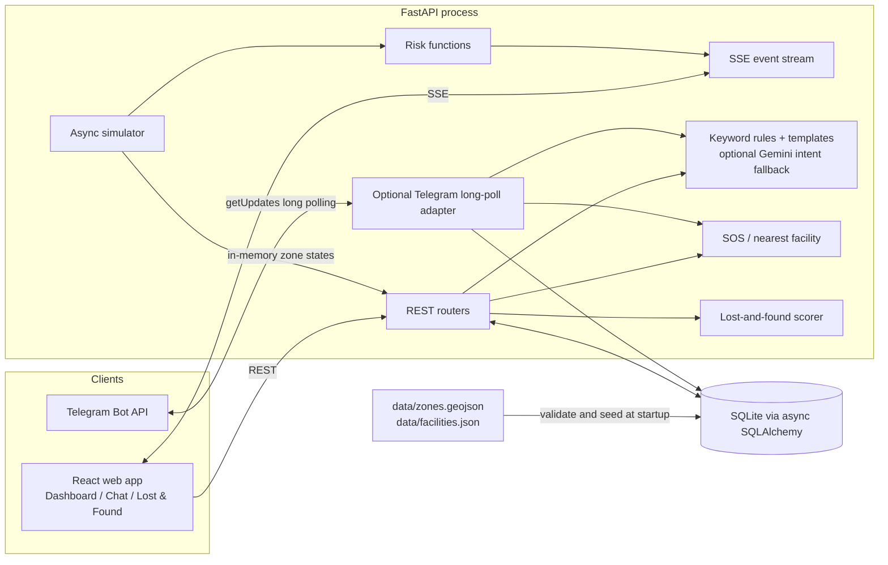

# KumbhRaksha — Technical Design Document

**Status:** Current-code design and submission reference. This document separates implemented behavior from target behavior; it is not an operational safety certification. All runtime crowd counts and provided facility records are simulation/demo inputs.

## 1. Goals and boundaries

KumbhRaksha prototypes a shared crowd-safety information workflow for a Kumbh Mela setting. The local system demonstrates zone mapping, deterministic simulated telemetry, risk labels and estimates, adjacent-zone suggestions, chat, SOS incident records, and text-only lost-and-found matching.

It does **not** currently ingest sensors, estimate real crowd counts, validate an accessible pedestrian route, provide authoritative facility status, dispatch response teams, or meet production security/availability requirements. The simulator and its outputs must remain visibly labelled **SIMULATED DATA**.

## 2. Architecture



Gemini is optional and only used on the web chat's unknown-intent fallback when `GEMINI_API_KEY` is set. It has a three-second timeout, digits are removed before the call, and the JSON is parsed into a Pydantic response model. User replies are rendered by templates. Telegram uses keyword rules in its adapter. SOS is checked in Python before the web chat classifier; lost-and-found matching is deterministic. No external LLM is used for SOS or matching.

## 3. Runtime lifecycle and data flow

1. `backend/app/main.py` enters FastAPI lifespan, creates SQLAlchemy tables, and reads zone/facility JSON from the repository `data/` directory.
2. Pydantic models validate the top-level data shapes. Existing validation is not yet exhaustive for GeoJSON geometry, coordinate ranges, duplicate IDs, adjacency cross-references or all external API payloads.
3. Existing rows are retained; absent zone/facility rows are seeded. Current code logs a warning and continues with empty records if a source file is missing. The project rule says required geography should instead fail clearly; reconcile this before relying on the service.
4. `sim.engine.init_from_zones` creates in-memory `ZoneState` entries. Initial count is currently `max(1, int(area_m2 * 0.1))`; it does not derive from `capacity_assumed`.
5. An asyncio task ticks at `SIM_TICK_SECONDS` (default 5), applies the current scenario, recomputes risk fields and broadcasts an SSE tick. Zone state is not persisted as a telemetry history.
6. The browser loads zone metadata over REST, listens to `/events`, and updates the map, counters and transition alert feed. The SSE client reconnects after errors; robust event replay and stale-data signaling are not implemented.
7. A second optional task runs Telegram long polling when configured. The local web application does not require a Telegram token.

### Data and process stores

| Store | Contents | Lifetime / notes |
|---|---|---|
| `data/zones.geojson` | Zone IDs, names, areas, assumed capacities, adjacency and polygons | Source data; do not invent or silently replace geometry. |
| `data/facilities.json` | Eight demo facility records, including coordinates and `demo: true` | Demo fixture; verify provenance and availability before real use. |
| SQLite | Zones, facilities, lost reports, incidents and subscription table | Database path is relative to the process working directory unless configured. Personal descriptors/chat IDs/incident coordinates can be persisted. |
| Process memory | Simulator state, SSE subscriber queues, web/Telegram chat sessions | Lost on process restart; not shared across workers. |
| Browser memory | Current dashboard state and recent alert feed | Rebuilt from REST/SSE; no durable event history. |

## 4. Components

### Backend

- `main.py`: lifespan, table creation, data seeding, simulator/Telegram task management, health check and simulator-control routes.
- `config.py`: Pydantic settings loaded from process environment and `.env`; database URL, risk thresholds, simulator cadence and alert cooldown.
- `database.py` / `models.py`: asynchronous SQLAlchemy engine/session and Zone, Facility, LostReport, Incident and Subscription models.
- `schemas.py`: Pydantic input/output models for zone data, chat, SOS, reports, matches and scenarios. Some request models still use plain strings/dicts and need stronger enums, bounds and strict input rules.
- `routers/`: zone reads, chat, SOS/incidents, reports/matches, SSE. There is no facilities API or complete subscriptions API.
- `sim/`: scenario registry, in-memory simulation and queue-based SSE broadcast.
- `risk.py`: density, risk level, threshold estimate and adjacent-zone selector.
- `chat/`: keyword classifier, optional Gemini intent fallback, and language templates.
- `sos.py`: SOS keyword check, Haversine distance and reply construction.
- `matching.py`: deterministic weighted matching of text reports.
- `adapters/telegram.py`: optional long-polling Telegram handler. It contains a chat path separate from the FastAPI `/chat` handler, so behavior can drift.

### Frontend

React 19 + TypeScript + Vite + React Router. `Dashboard.tsx` reads zones, derives visual alerts from SSE level transitions, polls incidents every 10 seconds and renders the map/side panel. `ZoneMap.tsx` renders GeoJSON polygons, facility markers when supplied, and incident markers. `ChatSim.tsx` calls `/chat`. `LostFound.tsx` submits text descriptors and renders returned candidate scores. `useSSE.ts` opens an `EventSource` and reconnects after an error. `SimBadge.tsx` provides the visible simulation label.

Leaflet requests base-map tiles from OpenStreetMap in the browser; the application does not bundle the tile map. If tile service/network access fails, the base map may be unavailable even though local zone data loaded.

## 5. Risk and simulation logic

### Current density bands

```text
density_people_per_m2 = count / area_m2
green   density < 1.0
yellow  1.0 <= density < 2.5
orange  2.5 <= density < 4.0
red     density >= 4.0
```

`compute_density` raises `ValueError` for `area_m2 <= 0`. Thresholds come from settings (`density_yellow`, `density_orange`, `density_red`). They are assumptions and must be validated by qualified event/crowd-safety stakeholders before operational use.

### Threshold estimate

```text
net_rate_people_per_second = (count_now - count_prev) / tick_seconds
red_count = density_red * area_m2
minutes_to_red = (red_count - count_now) / (net_rate_people_per_second * 60)
```

The current function returns no estimate for a nonpositive rate, an already-red zone, or an estimate at/above the configured 30-minute window. Positive counts are assumed. A single-tick linear extrapolation is not a calibrated crowd-flow model and must not be called a stampede prediction.

### Diversion suggestion

For a zone, consider only adjacent IDs present in the current in-memory map and whose risk level is not red. Return the candidate with lowest density; return `None` if none exists. This is adjacency selection, not pedestrian routing: it does not account for paths, closures, direction, accessibility, capacity or crowd movement between zones.

### Scenarios

The registry currently contains `calm` (default), `peak_snan_morning`, `evening_aarti`, and `stampede_risk`. Scenario rates are hard-coded illustrative deltas keyed by zone ID. The engine clamps counts but does not use field observations for calibration. Unknown scenario names currently raise `ValueError` from the endpoint path; convert to a well-formed client error.

## 6. API and event interface

| Method/path | Behavior |
|---|---|
| `GET /health` | Returns `{"status":"ok"}`; not a readiness check for loaded data or Telegram. |
| `GET /zones` | Returns zone geometry/metadata and current in-memory runtime values where loaded. |
| `GET /zones/{zone_id}` | Returns one zone or 404. |
| `GET /events` | SSE stream: initial `init`, `tick`, `reset`, and `incident` data messages. There is no persisted event replay. |
| `POST /sim/scenario` | Accepts `{"scenario":"peak_snan_morning"}`. Scenario names should be validated as an enum. |
| `POST /sim/reset` | Restores simulator seed counts and broadcasts a reset event; does not clear report/incident database rows. |
| `POST /chat` | Accepts `chat_id`, text, language and optional lat/lon; returns template text and optional buttons. Session state is in memory. |
| `POST /sos` | Accepts chat ID and location, saves incident, finds nearest configured facility and returns an SOS reply. |
| `GET /incidents` | Lists persisted incidents. Access control is not implemented. |
| `PATCH /incidents/{id}` | Sets status to acknowledged/resolved; request validation and authorization need strengthening. |
| `POST /report` | Stores a lost/found text report. Request constraints/authorization need strengthening. |
| `GET /matches/{report_id}` | For a lost report, returns up to three open found candidates with score breakdown. Current route does not enforce the documented 0.6 threshold. |
| `POST /matches/{found_report_id}/confirm` | Resolves the supplied found and lost IDs; verify ownership, types and match eligibility before production. |

The Telegram adapter uses the Bot API's long-polling `getUpdates` path. Do not configure a webhook, tunnel, `setWebhook`, or public IP for this project.

## 7. Data model and privacy

- **Zone:** ID, name, positive intended area/capacity, adjacency, GeoJSON geometry.
- **Facility:** ID, name, type, coordinate pair, optional zone ID, demo flag.
- **ZoneState:** in-memory count, previous count, density, risk level, forecast, divert suggestion and update time.
- **LostReport:** type, reporter chat ID, optional name/age/clothing/zone, timestamp and open/resolved status.
- **Incident:** chat ID, optional coordinates, nearest facility ID, status and timestamp.
- **Subscription:** chat ID, zone, language, creation time and last-alert time. The table exists, but the consent handler does not currently persist the subscription and proactive alert sending is incomplete.

The manual `scripts/purge_after_mela.py` deletes database rows from lost reports, incidents and subscriptions. It does not schedule deletion, clear in-memory chat state, clean backups, or remove any log/export. A production retention plan needs an owner, date, backup/log treatment, verification and a repeat-safe audit.

The SOS reply must not imply a response team has been dispatched: the prototype only records an incident and points to the nearest **demo** facility. Limit stored location/chat data, restrict incident/report access, avoid PII in logs, and add authentication/authorization before using real reports.

## 8. Security, reliability and known implementation gaps

1. CORS currently allows all origins with credentials; restrict it per deployment.
2. Telegram request logging emitted the configured bot API URL including its token during local startup. Rotate any token exposed in logs and redact/suppress HTTP client URL logs before enabling Telegram again.
3. The optional LLM parser validates a response model but its `intent` field is a plain string; allowlist intents before use. Keep template-only replies and fallback behavior.
4. SOS and lost-and-found are not to call an external LLM. Do not add image or biometric matching.
5. `/lite` must stay <=200 characters, plain text, no buttons/media on every route; expand tests for all return/error paths.
6. Chat/session state and simulator/SSE state are process-local; multiple workers will not share them.
7. Required source files currently warn-and-continue if missing; change to a clear startup failure for missing required geographic data.
8. Lost-and-found cutoff, consent persistence, subscription persistence, cooldown alert delivery and unsubscribe semantics are incomplete.
9. API input types and authorization need tightening; add integration tests, rate limits, monitoring and deployment readiness checks before operational use.
10. Facilities and capacities are unverified demo data. Adjacency is not a walking network.

## 9. Local development and verification

Follow the setup instructions in [`../README.md`](../README.md). Backend tests are in [`../backend/tests/`](../backend/tests/); sample fixtures/data are indexed in [`SAMPLE_DATA_AND_TESTS.md`](SAMPLE_DATA_AND_TESTS.md). API docs are available at `/docs` when the backend is running. This document does not claim that tests, production build, security review or an operational pilot have passed.

## 10. References within the repository

- Target product specification: [`BLUEPRINT.md`](BLUEPRINT.md).
- Hackathon portal answers and seven-slide plan: [`HACKATHON_SUBMISSION_REPORT.md`](HACKATHON_SUBMISSION_REPORT.md).
- Data source notes: [`../data/README.md`](../data/README.md).
- OpenStreetMap attribution: <https://www.openstreetmap.org/copyright>.
